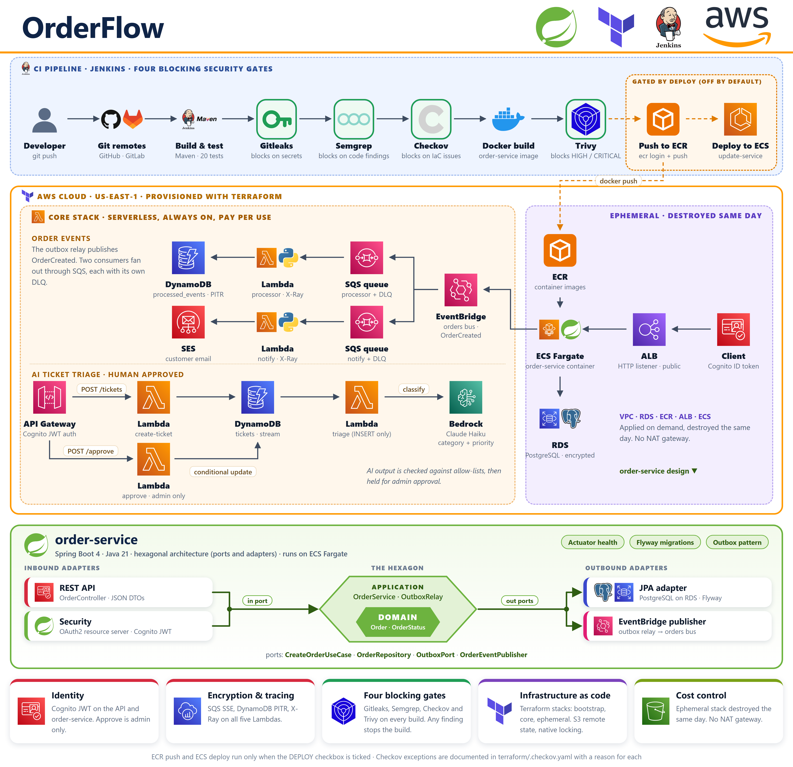

# OrderFlow-AWS-Terraform

A small event-driven order and support-ticket platform on AWS, built to practice cloud engineering with Terraform and CI/CD.

## Features

- **Orders:** a Spring Boot `order-service` on ECS Fargate saves orders in PostgreSQL and publishes `OrderCreated` events to EventBridge.
- **Event processing:** SQS queues with dead-letter queues feed Python Lambdas that store events in DynamoDB and email customers through SES.
- **Support tickets:** customers open tickets through API Gateway and Lambda. Amazon Bedrock triages each ticket and an admin approves it.
- **Login:** both APIs use Amazon Cognito JWTs.
- **Infrastructure as code:** three Terraform stacks. The costly resources (RDS, ALB) live in an on-demand stack that can be destroyed on its own.
- **CI/CD:** a Jenkins pipeline with Gitleaks, Semgrep, Checkov and Trivy scans before deploying to ECS.

## Tech stack

Java 21 · Spring Boot · Python · Terraform · AWS (ECS Fargate, ECR, RDS, EventBridge, SQS, Lambda, DynamoDB, API Gateway, Cognito, SES, Bedrock) · Docker · Jenkins

## Related project

[OrderManagement-Kafka](https://github.com/KarimElOuahabi/OrderManagement-Kafka): a similar project built with Kafka and Docker.
